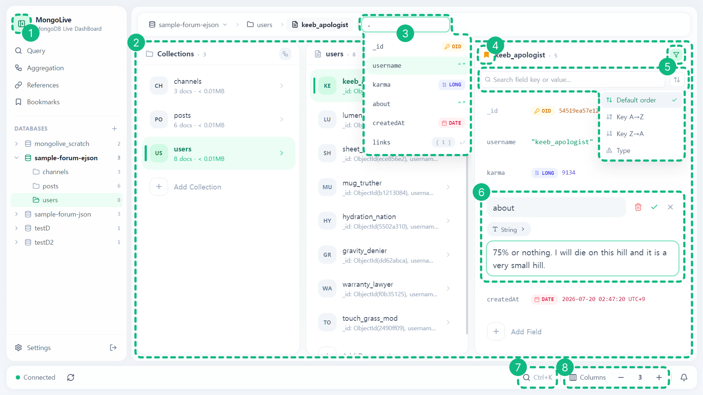
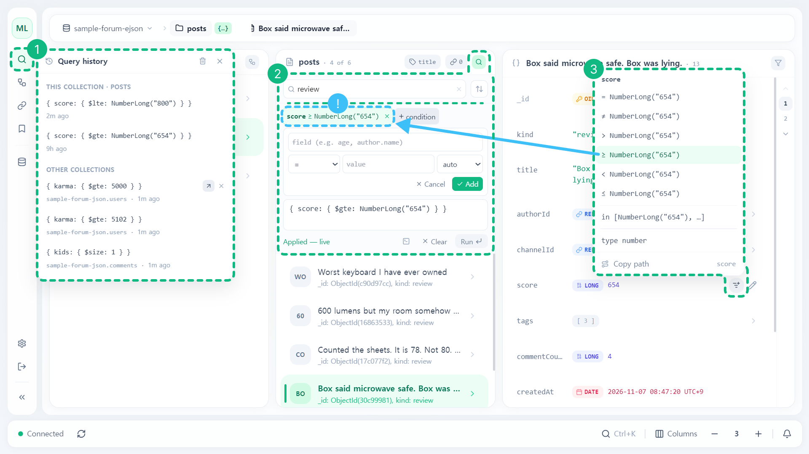
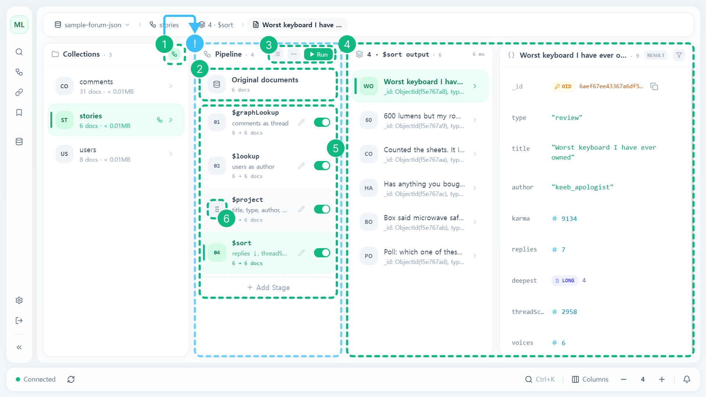
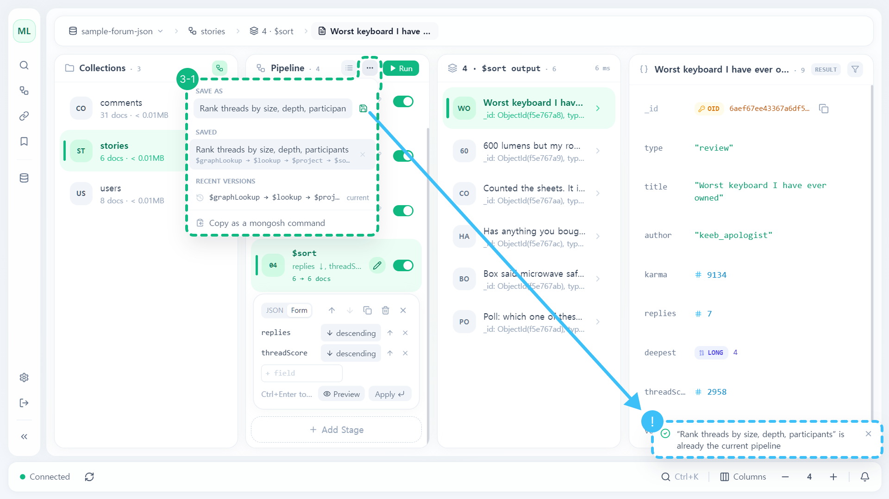
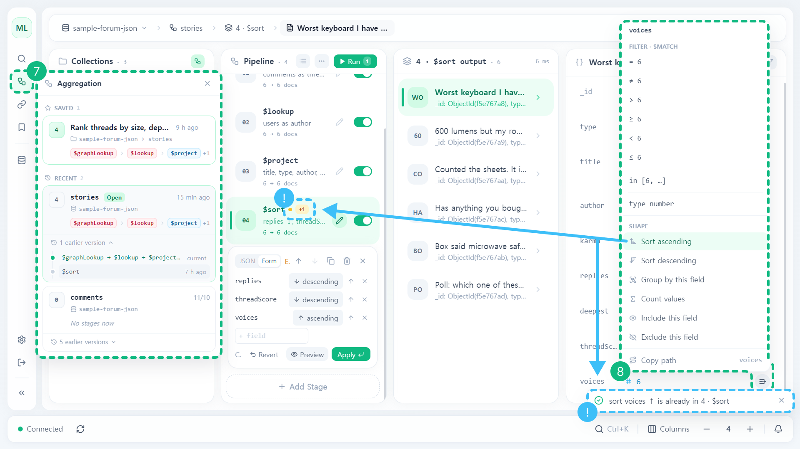
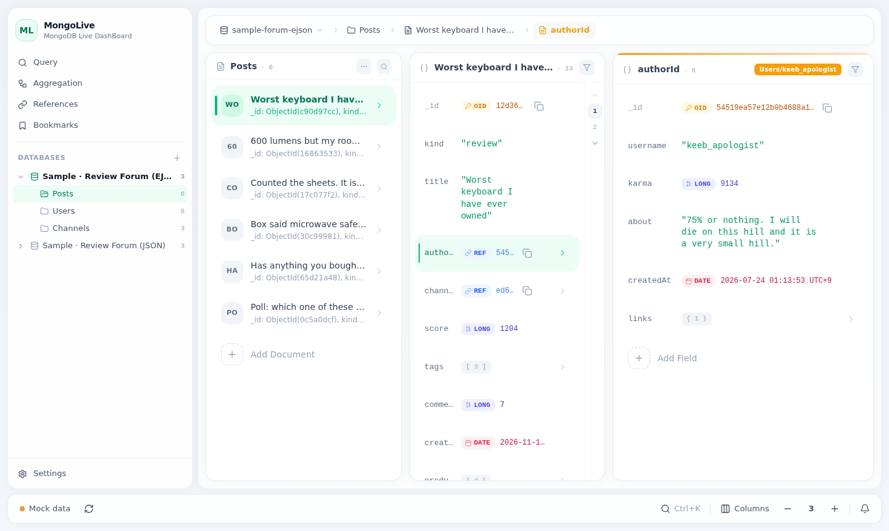
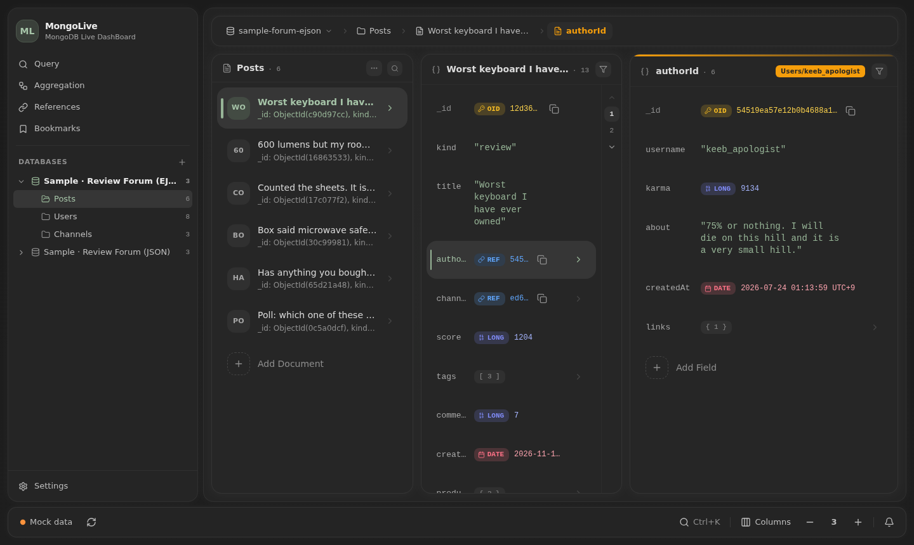

<div align="center">

# MongoLive - MongoDB Live Dashboard

**A column-based, realtime MongoDB data explorer**

[한국어](README.md) · **English**


[](LICENSE)

### 🔗 [Open the live demo](https://jsbeep.github.io/mongolive/)

[Features](#features) · [Getting started](#getting-started) · [Configuration](#configuration) · [Keyboard](#keyboard) · [Architecture](#architecture) · [Development](#development)

</div>

> ⚠️ **This is a beta.**<br>
> Features and screens may change without notice<br>
> Bugs and suggestions welcome → [Issues](https://github.com/jsbeep/mongolive/issues)

---

[demo.mp4](https://github.com/user-attachments/assets/ef931da9-9cf5-483c-8684-c254a1ba115c)

- Try it with sample data saved in your browser's localStorage
- Not in the demo: realtime updates, change history, login
- Queries and aggregation in the demo run on [[mingo](https://github.com/kofrasa/mingo)] and may differ slightly from real MongoDB

## Previous projects
| Project | What came from it |
|---|---|
| [Mongolive_legacy](https://github.com/jsbeep/Mongolive_legacy) | Realtime MongoDB monitoring via changeStream + WebSocket, subscribed by the client's current path |
| [Json-explorer](https://github.com/jsbeep/Json-explorer) | Miller column explorer, inline editor, PK/FK reference model |

## Features

### Exploring


| # | Feature |
|---|---|
| 1 | Collapsible sidebar — full / icons / hidden (Ctrl+B) |
| 2 | Miller column drill-down — DB → collection → document → nested fields |
| 3 | Type a path right in the breadcrumb — field key autocomplete |
| 4 | Bookmark from a column's icon |
| 5 | Field text search + sort (default order / key A→Z·Z→A / type) |
| 6 | Inline editor per BSON type (ObjectId, Date (in the display time zone), Int32 / Long / Double / Decimal128) |
| 7 | Ctrl+K quick jump — DB and collection names, paste an ObjectId |
| 8 | Column count + tree mode that nests levels in one panel 🪾 |

- Keyboard-only navigation (↑↓←→ / hjkl)

### Editing
- Canonical EJSON throughout
- Drag to reorder array items and object keys, multi-level Undo (Ctrl+Z)
- Concurrent edit conflict detection — if the value changed elsewhere while you were editing, confirm before overwriting


### References
- Automatic ObjectId reference tracking
- String and number references (e.g. `authorId` → `users.id`) followed once declared as PK/FK

https://github.com/user-attachments/assets/918f102d-6519-4949-b653-bb587b5ea0ef

### Query


| # | Feature |
|---|---|
| 1 | Sidebar Query — query history (this collection / other collections, ↗ run in that collection) |
| 2 | Text filter & sort + query panel, condition chips (`+ condition`) and form, copy as a mongosh command |
| 3 | Query right while browsing documents — `=`, `≠`, `>`, `≥`, `<`, `≤`, `in`, type |

- Quick conditions per type: comparisons, same day, array state, and more

### Aggregation


| # | Feature |
|---|---|
| 1 | Aggregation mode toggle — opens the Pipeline column |
| 2 | Original documents — browse the source documents |
| 3 | Cards ⇄ JSON input · `⋯` menu · run the pipeline |
| 4 | Stage output + result detail (read-only `RESULT`) |
| 5 | Stage cards — documents passed per stage (`6 → 6 docs`), stage toggle, edit, add |
| 6 | Drag to reorder stages |



| # | Feature |
|---|---|
| 3-1 | `⋯` menu — save / saved list / recent versions / copy as a mongosh command |



| # | Feature |
|---|---|
| 7 | Sidebar Aggregation — saved and recent pipelines per collection, earlier-version timeline |
| 8 | Pipeline Collect — add to the pipeline from a field's menu while exploring results; `$match`·`$sort` merge into the existing stage, the rest become new stages → Run |

- Collected changes counted on the card (`+1`); a condition that's already there only shows a notice
- Stage editor in JSON / Form ($match, $group, $lookup, $sort, $limit, $skip, $sample)
- Read-only output; stages that write to the DB (`$out`·`$merge`) are blocked

### Realtime
- Realtime monitoring with MongoDB changeStream
    - Subscribes to the DB·collection you're viewing + 150 ms batching updates only the affected parts
- Concurrent edit conflict detection
- Notification center

[Realtime — external changes reflected / edit conflict detection](https://github.com/user-attachments/assets/34b95a21-75f0-4a48-a471-6eca4e308fcd)

### Safety
- Read-only mode / protected DBs·collections / confirm before deleting
- Exploration that never touches your data — app metadata such as reference declarations, title fields and settings is stored separately on the server in `~/.mongolive/`
- Password login (scrypt)
- HTTPS required — when exposed externally without HTTPS or a proxy setup, the server refuses to start

### Etc.
- Dark theme (Nord), date and ObjectId display formats, monospace font choice, settings export/import

| Light | Dark |
|---|---|
|  |  |

## Getting started
### 1. Install MongoDB
### 2. Create a replica set
for changestream

[🔗 Deploy a replica set (MongoDB docs)](https://www.mongodb.com/docs/manual/tutorial/deploy-replica-set/)
### 3. Node.js 22.9 or later
### 4. Install + set up `.env`
```bash
git clone https://github.com/jsbeep/mongolive.git
cd mongolive
corepack pnpm install

cp apps/server/.env.example apps/server/.env   # fill in MONGODB_URI
```
### 5. Set a password and run
```bash
corepack pnpm set-password      # login password
corepack pnpm build:web:remote  # build the web UI
corepack pnpm start             # → http://127.0.0.1:4000
```

By default only this machine can connect (127.0.0.1). To use it from other devices, see the [deployment & security guide](docs/deployment.md) (Korean)

### Dev mode
```bash
corepack pnpm dev:server       # API server (4000)
corepack pnpm dev:web:remote   # web (5173) — forwards /api and /socket.io to the server
corepack pnpm dev:web          # mock data without a server (same mode as the demo)
```

## Configuration
`apps/server/.env`<br>
Full reference: [`.env.example`](apps/server/.env.example) (comments in Korean)

| Name | Default | Description |
|---|---|---|
| `MONGODB_URI` | (required) | MongoDB connection string (replica set) |
| `HOST` / `PORT` | `127.0.0.1` / `4000` | Server address / port |
| `AUTH_MODE` | `password` | Login method |
| `TLS_CERT` / `TLS_KEY` | — | Required to serve HTTPS |
| `TRUST_PROXY` | `false` | HTTPS through a proxy (Caddy, nginx, Tailscale, etc.) |
| `ALLOW_INSECURE_HTTP` | `false` | Expose over plain HTTP (development only) |
| `AUTH_FILE` / `META_FILE` / `SETTINGS_FILE` | `~/.mongolive/…` | Locations of the password hash, app metadata and safety settings files |

## Keyboard
| Key | Action |
|---|---|
| ↑ ↓ ← → / h j k l | Move between columns and items |
| Enter | Open |
| e / F2 | Edit |
| Delete | Delete |
| / | Filter |
| q | Query |
| ? | Shortcut list |
| Ctrl+K | Quick jump |
| Ctrl+B | Collapse / expand the sidebar |
| Ctrl+Z | Undo |

## Architecture
```
apps/web         Vite + React 18 + TypeScript + Tailwind CSS + Motion
apps/server      Express + MongoDB Node.js Driver + Socket.IO (TypeScript, tsx)
packages/shared  EJSON, query parser, validators, pipeline rules — shared by web and server (Vitest)
```
```
Browser ──REST /api (Canonical EJSON)──▶ Server ──▶ MongoDB
   ▲                                                   │
   └────────── Socket.IO ◀──── changeStream ───────────┘
```
#### Frontend (apps/web)
- `DataSource` → UI — two implementations: the server one and an in-browser mock
- Which one to use is set at build time with `VITE_DATA_SOURCE`; the demo is the mock + mingo
#### Backend (apps/server)
- One changeStream watches the whole cluster; each client joins only the rooms of the DB·collection it's viewing and receives just those changes
- Writes apply only "if the value I saw is still there" — they never overwrite a change made elsewhere first

## Built with
- **AI**
    - **Claude Code** thank you
- **Development**
    - **React 18, Vite, TypeScript**
    - **TailwindCSS, Lucide-react, Motion**
    - **Express, MongoDB Node.js Driver, Socket.IO**
    - **pnpm monorepo, Vitest**

## Development
```bash
corepack pnpm typecheck
corepack pnpm test

# demo build (same settings as GitHub Pages)
VITE_DEMO=true corepack pnpm --filter @mongolive/web exec vite build --base=/mongolive/
```
`main` push → GitHub Actions → GitHub Pages ([`.github/workflows/demo.yml`](.github/workflows/demo.yml))

## Acknowledgements
- [mingo](https://github.com/kofrasa/mingo): queries and aggregation in the demo (MIT)
- [Lucide](https://lucide.dev/): icons (ISC)
- [React](https://react.dev/), [Vite](https://vite.dev/), [Tailwind CSS](https://tailwindcss.com/), [Motion](https://motion.dev/), [Socket.IO](https://socket.io/), [MongoDB Node.js Driver](https://github.com/mongodb/node-mongodb-native)
- REF: [MongoDB Compass](https://www.mongodb.com/products/tools/compass), [Google Firestore console panel view](https://firebase.google.com/docs/firestore/using-console), macOS Finder column view, VS Code status bar

The original license texts of the libraries bundled into the web build are in the build output's `THIRD-PARTY-LICENSES.txt` → [demo](https://jsbeep.github.io/mongolive/THIRD-PARTY-LICENSES.txt)

## License
[MIT](LICENSE)
