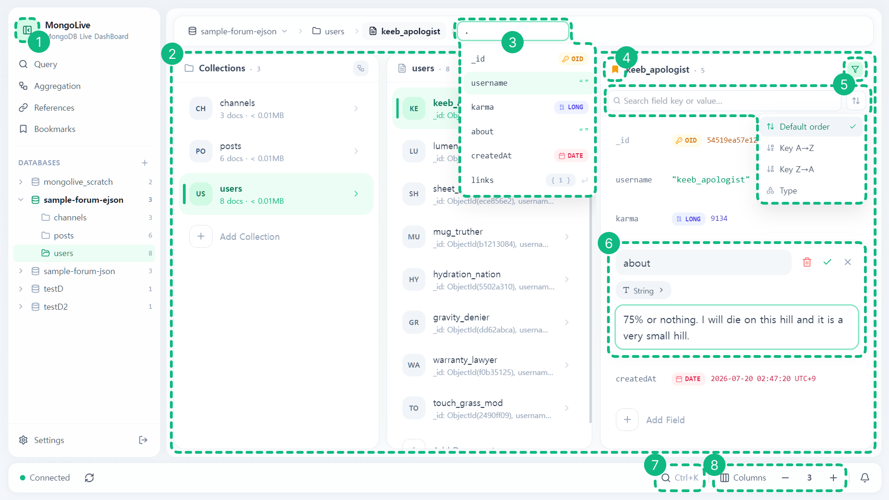
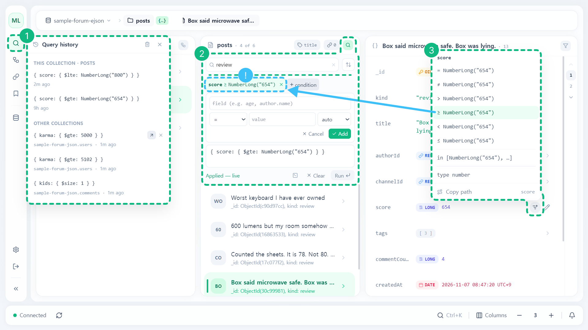
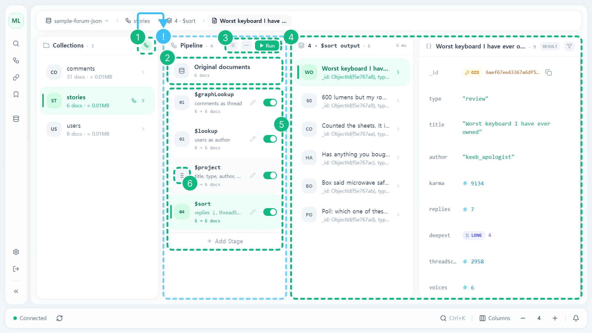
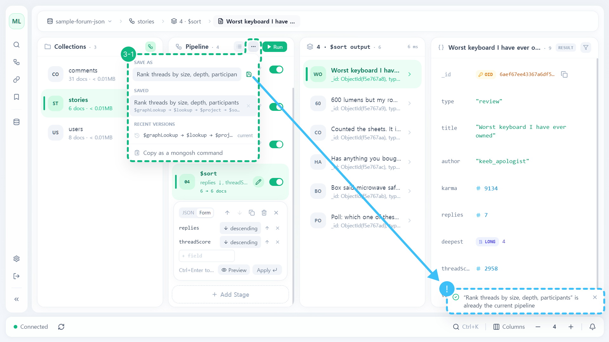
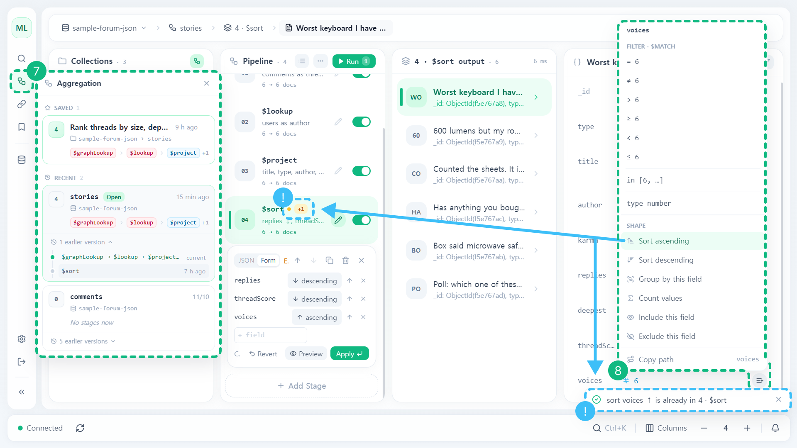
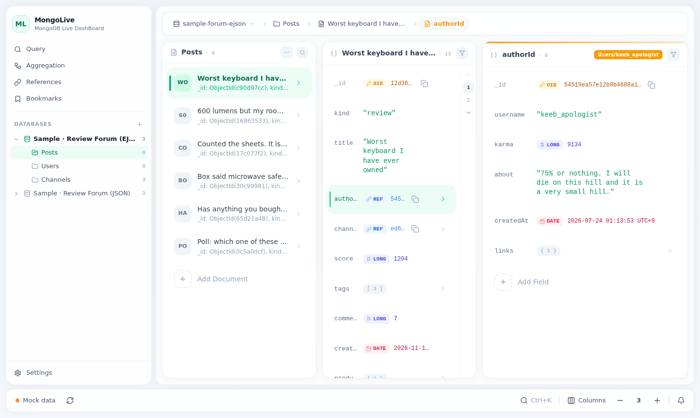
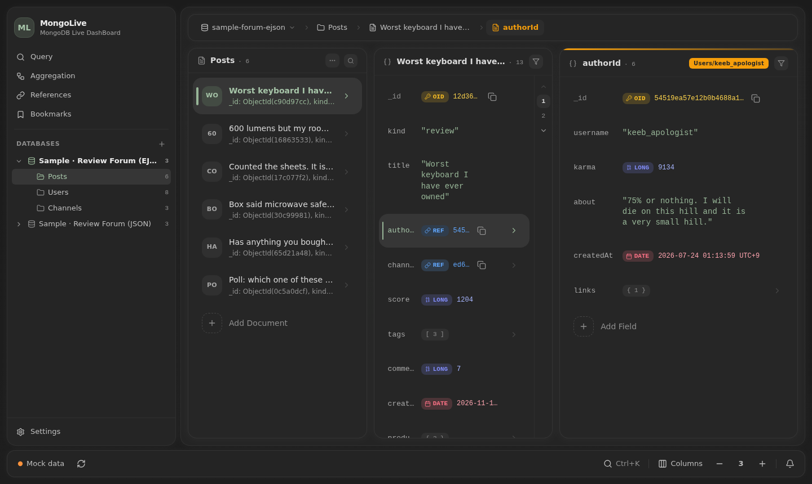

<div align="center">

# MongoLive - MongoDB Live Dashboard

**컬럼 기반 실시간 MongoDB 데이터 탐색기**

**한국어** · [English](README.en.md)


[](LICENSE)

### 🔗 [라이브 데모 열기](https://jsbeep.github.io/mongolive/)

[기능](#기능) · [시작하기](#시작하기) · [설정](#설정) · [키보드](#키보드) · [구조](#구조) · [개발](#개발)

</div>

> ⚠️ **베타입니다.**<br>
> 기능과 화면이 예고 없이 바뀔 수 있음<br>
> 버그·제안 환영 → [Issues](https://github.com/jsbeep/mongolive/issues)

---

[demo.mp4](https://github.com/user-attachments/assets/ef931da9-9cf5-483c-8684-c254a1ba115c)

- localStorage에 저장되는 샘플 데이터 시식
- 데모에 없는 것: 실시간 반영, 변경 기록, 로그인
- 데모의 쿼리·집계[[mingo](https://github.com/kofrasa/mingo)]는 실제 MongoDB와 조금 다를 수 있음

## 이전 프로젝트
| 프로젝트 | 가져온 것 |
|---|---|
| [Mongolive_legacy](https://github.com/jsbeep/Mongolive_legacy) | changeStream-websocket 클라이언트 경로 구독 기반  MongoDB 실시간 감시 |
| [Json-explorer](https://github.com/jsbeep/Json-explorer) | Miller Column 탐색기, 인라인 에디터, PK/FK 참조 모델 |

## 기능

### 탐색


| # | 기능 |
|---|---|
| 1 | 사이드바 접기/펴기 — 전체 / 아이콘 / 완전히 접기 (Ctrl+B) |
| 2 | Miller Column 드릴다운 — DB → 컬렉션 → 문서 → 중첩 필드 |
| 3 | breadcrumb 경로 직접 입력 — 필드 키 자동완성 |
| 4 | 컬럼 아이콘으로 북마크 |
| 5 | 필드 문자열 검색 + 정렬 (기본 순서 / 키 A→Z·Z→A / 타입) |
| 6 | 인라인 편집기 — BSON 타입별 (ObjectId, Date(표시 시간대 기준), Int32 / Long / Double / Decimal128) |
| 7 | Ctrl+K 빠른 이동 — DB·컬렉션 이름, ObjectId 붙여넣기 |
| 8 | 컬럼 개수 조절 + 패널 중첩 트리 모드 🪾 |

- 키보드로만 이동(↑↓←→ / hjkl)

### 편집
- Canonical EJSON 사용
- 배열 항목·객체 키 드래그로 순서 바꾸기, 여러 단계 Undo(Ctrl+Z)
- 동시 수정 충돌 감지 — 수정 중 현재 값이 오래된 경우(외부 수정) 덮어쓰기 전 확인


### 참조
- ObjectId 자동 참조 추적
- 문자열·숫자 참조(예: `authorId` → `users.id`) PK/FK 선언 추적

https://github.com/user-attachments/assets/918f102d-6519-4949-b653-bb587b5ea0ef

### 쿼리


| # | 기능 |
|---|---|
| 1 | 사이드바 Query — 쿼리 기록 (이 컬렉션 / 다른 컬렉션, ↗ 해당 컬렉션에서 실행) |
| 2 | 텍스트 필터·정렬 + 쿼리 패널, 조건 칩(`+ condition`) 및 form, mongosh 커맨드 복사 |
| 3 | 문서 탐색중 즉시 쿼리 — `=`, `≠`, `>`, `≥`, `<`, `≤`, `in`, 타입 |

- 부등호, 같은 날, 배열 상태 등 타입별 빠른 조건

### 집계 (Aggregation)


| # | 기능 |
|---|---|
| 1 | 집계 모드 토글 — 파이프라인 컬럼 진입 |
| 2 | Original documents — 원본 문서 탐색 |
| 3 | 카드 ⇄ JSON 입력 전환 · `⋯` 메뉴 · 파이프라인 실행 |
| 4 | 스테이지 출력 + 결과 상세 (읽기 전용 `RESULT`) |
| 5 | 스테이지 카드 — 지나간 문서 수(`6 → 6 docs`), 스테이지 토글, 편집, 추가 |
| 6 | 드래그로 스테이지 순서 바꾸기 |



| # | 기능 |
|---|---|
| 3-1 | `⋯` 메뉴 — 저장 / 저장 목록 / 최근 버전 / mongosh 명령으로 복사 |



| # | 기능 |
|---|---|
| 7 | 사이드바 Aggregation — 컬렉션별 저장 목록·최근 파이프라인, 이전 버전 타임라인 |
| 8 | Pipe결과 탐색 중 필드 메뉴로 파이프라인에 모으기 — `$match`·`$sort`는 기존 스테이지 병합, 나머지는 새 스테이지 → Run |

- 모은 변경 수(`+1`) 카드에 표시, 이미 있는 조건이면 알림만 |
- 스테이지 편집기 JSON / Form ($match, $group, $lookup, $sort, $limit, $skip, $sample)
- 읽기 전용 출력, DB에 쓰는 스테이지(`$out`·`$merge`) 블락

### 실시간
- MongoDB changeStream 실시간 감시
    - 열람 중인 DB·컬렉션 구독 + 150ms 배칭으로 영향 부분만 갱신
- 동시 수정 충돌 감지
- 알림 센터

[실시간 — 문서 외부변경 반영/수정 충돌 감지](https://github.com/user-attachments/assets/34b95a21-75f0-4a48-a471-6eca4e308fcd)

### 안전
- 읽기 전용 모드/보호할 DB·컬렉션 지정/지우기 전 확인
- 원본 데이터에 개입하지 않는 탐색 — 참조 선언, 제목 필드, 설정 같은 앱 메타데이터는 서버의 `~/.mongolive/`에 따로 저장됨
- 비밀번호 로그인(scrypt), 
- HTTPS 필수 정책 — 외부 공개 시 HTTPS 또는 프록시 환경이 구성되지 않으면 서버 구동 차단

### 그 밖에
- 다크 테마(Nord), 날짜·ObjectId 표시 방식, 고정폭 글꼴 선택, 설정 내보내기/가져오기

| 라이트 | 다크 |
|---|---|
|  |  |

## 시작하기
### 1. MongoDB 설치
### 2. Replica Set 만들기
for changestream

[🔗 Mongodb Replica Set 구축하기](https://medium.com/@zzanzu/mongodb-replica-set-%EA%B5%AC%EC%B6%95%ED%95%98%EA%B8%B0-be7df973801d)
### 3. Node.js 22.9 이상
### 4. 설치 + `.env` 설정
```bash
git clone https://github.com/jsbeep/mongolive.git
cd mongolive
corepack pnpm install

cp apps/server/.env.example apps/server/.env   # MONGODB_URI 채우기
```
### 5. 비밀번호 정하고 실행
```bash
corepack pnpm set-password      # 로그인 비밀번호
corepack pnpm build:web:remote  # 웹 화면 빌드
corepack pnpm start             # → http://127.0.0.1:4000
```

기본은 이 기기에서만 접속(127.0.0.1), 다른 기기에서 쓰려면 [배포·보안 가이드](docs/deployment.md)

### 개발 모드
```bash
corepack pnpm dev:server       # API 서버 (4000)
corepack pnpm dev:web:remote   # 웹 (5173) — /api, /socket.io를 서버로 넘김
corepack pnpm dev:web          # 서버 없이 Mock 데이터로 (데모랑 같은 모드)
```

## 설정
`apps/server/.env`<br> 
전체 설명: [`.env.example`](apps/server/.env.example)

| 이름 | 기본값 | 설명 |
|---|---|---|
| `MONGODB_URI` | (필수) | MongoDB 접속 주소(replica set) |
| `HOST` / `PORT` | `127.0.0.1` / `4000` | 서버 주소 / 포트 |
| `AUTH_MODE` | `password` | 로그인 방식 |
| `TLS_CERT` / `TLS_KEY` | — | HTTPS 구동 조건 |
| `TRUST_PROXY` | `false` | 프록시(Caddy, nginx, Tailscale 등) HTTPS |
| `ALLOW_INSECURE_HTTP` | `false` | 외부에 HTTP로 열기(개발전용) |
| `AUTH_FILE` / `META_FILE` / `SETTINGS_FILE` | `~/.mongolive/…` | 비밀번호 해시, 앱 메타데이터, 안전 설정 파일 위치 |

## 키보드
| 키 | 동작 |
|---|---|
| ↑ ↓ ← → / h j k l | 컬럼·항목 이동 |
| Enter | 열기 |
| e / F2 | 편집 |
| Delete | 지우기 |
| / | 필터 |
| q | 쿼리 |
| ? | 단축키 목록 |
| Ctrl+K | 빠른 이동 |
| Ctrl+B | 사이드바 접기/펴기 |
| Ctrl+Z | 되돌리기 |

## 구조
```
apps/web         Vite + React 18 + TypeScript + Tailwind CSS + Motion
apps/server      Express + MongoDB Node.js Driver + Socket.IO (TypeScript, tsx)
packages/shared  EJSON, 쿼리 파서, 검사, 파이프라인 규칙 — 웹·서버 공용 (Vitest)
```
```
브라우저 ──REST /api (Canonical EJSON)──▶ 서버 ──▶ MongoDB
   ▲                                              │
   └────────── Socket.IO ◀──── changeStream ──────┘
```
#### 프론트엔드 (apps/web)
- `DataSource` -> 화면 — 서버 구현, 브라우저 내부 Mock 구현 두 개
- 어느 쪽 쓸지는 빌드 시 `VITE_DATA_SOURCE`로 설정, 데모는 Mock + mingo
#### 백엔드 (apps/server)
- changeStream 하나로 클러스터 전체 감시, 클라이언트는 보고 있는 DB·컬렉션 방에만 들어가서 그 변경만 받음
- 쓰기는 "내가 본 값이 아직 그대로일 때만" 반영 — 다른 데서 먼저 바꾼 걸 덮어쓰지 않음

## 환경
- **AI**
    - **Claude Code** thank you
- **개발**
    - **React 18, Vite, TypeScript**
    - **TailwindCSS, Lucide-react, Motion**
    - **Express, MongoDB Node.js Driver, Socket.IO**
    - **pnpm 모노레포, Vitest**

## 개발
```bash
corepack pnpm typecheck
corepack pnpm test

# 데모 빌드 (GitHub Pages와 같은 설정)
VITE_DEMO=true corepack pnpm --filter @mongolive/web exec vite build --base=/mongolive/
```
`main` push -> GitHub Actions -> GitHub Pages ([`.github/workflows/demo.yml`](.github/workflows/demo.yml))

## 감사의 말
- [mingo](https://github.com/kofrasa/mingo): 데모의 쿼리·집계 (MIT)
- [Lucide](https://lucide.dev/): 아이콘 (ISC)
- [React](https://react.dev/), [Vite](https://vite.dev/), [Tailwind CSS](https://tailwindcss.com/), [Motion](https://motion.dev/), [Socket.IO](https://socket.io/), [MongoDB Node.js Driver](https://github.com/mongodb/node-mongodb-native)
- REF: [MongoDB Compass](https://www.mongodb.com/ko-kr/products/tools/compass), [Google Firestore 패널 뷰](https://firebase.google.com/docs/firestore/using-console?hl=ko), macOS Finder 컬럼 보기, VS Code 상태 표시줄

웹 빌드에 함께 들어가는 라이브러리 라이선스 원문은 빌드 결과의 `THIRD-PARTY-LICENSES.txt` → [데모](https://jsbeep.github.io/mongolive/THIRD-PARTY-LICENSES.txt)

## 라이선스
[MIT](LICENSE)
